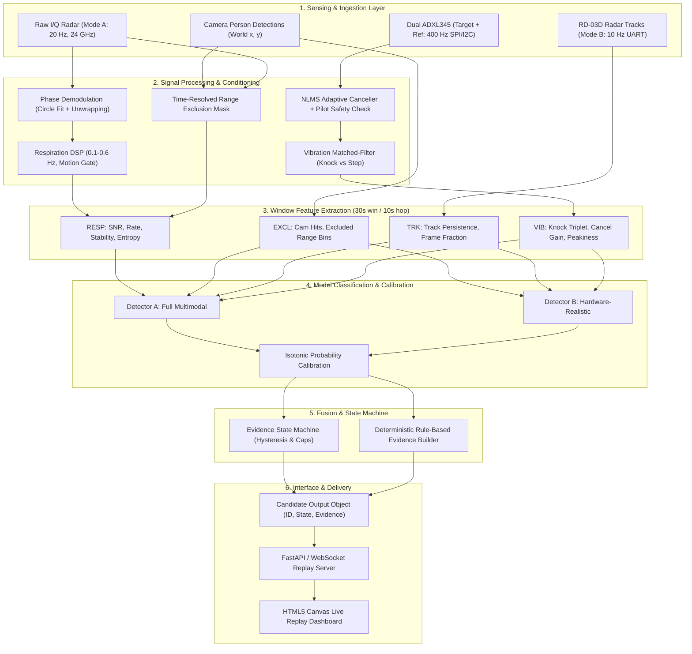
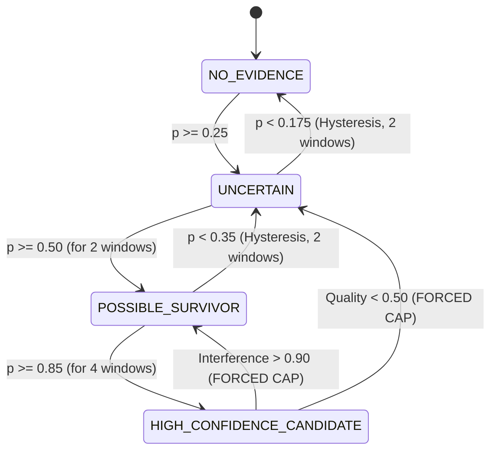

# VibroSAR System Documentation

> **CRITICAL NOTICE: SIMULATOR-FIRST RESEARCH PROTOTYPE**  
> Physical hardware integration is currently on hold. All benchmark results, trained model checkpoints, and dashboard replays in this repository are derived from **SYNTHETIC data** generated by the physics-motivated simulation suite (`simulator/`). Model confidence scores reflect synthetic validation performance and must **NEVER** be interpreted as validated real-world survival probabilities for life-critical rescue decisions.

---

## 1. Project Overview & Philosophy

**VibroSAR** is a multi-modal Search and Rescue (SAR) software core designed to detect victims trapped beneath structural rubble and collapsed buildings following earthquakes, explosions, or structural failures.

Traditional disaster response often relies on rescue dogs, acoustic search cameras, or ground-penetrating radar operated in isolation. VibroSAR unifies three complementary sensing modalities:
1. **Radar**: Micro-motion vital sign detection (respiration chest displacement) and moving target tracking.
2. **Seismic / Structural Vibration**: Dual-accelerometer sensing capturing survivor distress knocks while adaptively cancelling local heavy machinery interference.
3. **Computer Vision (Camera)**: Spatial mapping of visible rescue workers and surface personnel to eliminate false positives caused by living people outside the rubble.

### Guiding Principles
- **"Unknown Beats False Certainty"**: The system never outputs ungrounded candidate probabilities. If interference is severe or signal quality is degraded, the state machine clamps the candidate state to `UNCERTAIN` or `POSSIBLE_SURVIVOR`.
- **Traceable Evidence**: Every candidate assessment is accompanied by deterministic, rule-based evidence indicators (e.g., knock triplet timing, respiration rate/SNR, pilot recovery).
- **Explicit Provenance**: Every internal data packet, feature vector, and candidate structure carries a mandatory `synthetic: bool` flag to prevent simulated data from contaminating real operational records.
- **Hardware-Realistic Separation (Detectors A & B)**:
  - **Detector A (`A_full_sim`)**: Explores the theoretical ceiling assuming access to raw I/Q phase radar (sub-millimeter respiration demodulation).
  - **Detector B (`B_hardware_like`)**: Constrained strictly to low-cost, off-the-shelf hardware (24 GHz RD-03D track data + camera + dual ADXL345 accelerometers).

---

## 2. System Architecture



---

## 3. Hardware Interfaces & Protocols

### 3.1 Dual-Accelerometer Vibration Subsystem
- **Microcontroller**: ESP32 DevKit (Firmware: `firmware/esp32_adxl345/esp32_adxl345.ino`).
- **Sensors**: 2x Analog Devices ADXL345 3-axis digital accelerometers operating on shared I2C bus (400 kHz Fast Mode):
  - **Sensor 0 ("target")**: Placed on or coupled to the rubble surface; $SDO \rightarrow GND$ (I2C address `0x53`).
  - **Sensor 1 ("reference")**: Mounted adjacent to active rescue machinery/generators; $SDO \rightarrow 3V3$ (I2C address `0x1D`).
- **Configuration**: Full-resolution mode, $\pm 2g$ measurement range, 400 Hz output data rate ($3.9\text{ mg/LSB} \approx 0.0039\text{ g/count}$).
- **Serial Connection**: 921,600 baud, 8N1.

#### ESP32 Binary Protocol Framing (v1)
Each frame bundles 20 samples (50 ms payload) to minimize serial overhead:

| Byte Offset | Field | Type | Description |
|---|---|---|---|
| `0..1` | Header | `uint8[2]` | Sync magic: `0xA5`, `0x5A` |
| `2` | Version | `uint8` | Protocol version (`0x01`) |
| `3..4` | Sequence | `uint16_t` | Incremental frame sequence counter |
| `5..8` | Timestamp | `uint32_t` | Scheduled microsecond timestamp (`micros()`) |
| `9..10` | Sampling Rate | `uint16_t` | `400` Hz |
| `11` | Channels | `uint8` | `2` (Channel 0: Target Z, Channel 1: Ref Z) |
| `12` | Samples | `uint8` | `20` samples per frame |
| `13..92` | Payload | `int16_t[40]` | Interleaved little-endian signed 16-bit counts |
| `93..94` | Checksum | `uint16_t` | CRC-16/CCITT-FALSE across bytes `2..92` |

### 3.2 Radar Subsystem
- **Hardware Supported**: Ai-Thinker / Ishine RD-03D 24 GHz FMCW multi-target radar module.
- **Interface**: UART serial at 256,000 baud.
- **Packet Handling (`backend/sensors/radar_tracks.py`)**: Frames decoded into `RadarTrack` objects containing $(x_{\text{mm}}, y_{\text{mm}}, v_{\text{cm/s}}, \text{resolution})$. Up to 3 simultaneous targets reported at 10 Hz.
- **Mode A (Simulated)**: 24 GHz ($\lambda = 12.5\text{ mm}$), 64 range bins at 0.1 m resolution (6.4 m total range), 20 Hz slow-time complex I/Q samples.

---

## 4. Signal Processing & DSP Pipeline

### 4.1 Phase Demodulation & Circle-Fitting (`backend/processing/phase.py`)
In FMCW radar, chest displacement $d(t)$ introduces a phase shift:
$$\Delta \phi(t) = \frac{4\pi}{\lambda} d(t)$$
At $\lambda = 12.5\text{ mm}$, a 4 mm chest displacement yields $\approx 4.02\text{ rad}$ peak-to-peak phase swing, placing the signal deep into the non-linear sinusoidal regime.
1. **Circle Fitting**: Algebraic Kåsa/Taubin circle fitting on the complex trajectory $z(t)$ determines DC offsets and IQ center $(c_x, c_y)$.
2. **Arctangent Demodulation**: Calculates $\theta(t) = \text{atan2}(z(t) - c)$, performs phase unwrapping across $[-\pi, \pi]$ discontinuities, and converts phase back to millimeters:
   $$d(t) = \theta_{\text{unwrapped}}(t) \cdot \frac{\lambda}{4\pi}$$

### 4.2 Respiration Feature Extraction (`backend/processing/respiration.py`)
Operating on 30-second windows with zero-phase 4th-order Butterworth bandpass (0.10–0.60 Hz / 6–36 breaths/min):
- **Large-Motion Gating**: Dissects windows into 4 s sub-segments. If peak-to-peak displacement exceeds 20 mm in $>25\%$ of sub-segments (indicative of walking or major body shifting), the window is flagged **invalid** and scored 0.
- **Amplitude Non-Stationarity**: Gated by amplitude coefficient of variation ($CV \le 0.30$) to prevent walking targets passing through a bin from mimicking breathing.
- **Extracted Features**:
  - `resp_rate_hz`: Dominant spectral peak frequency via 4096-point FFT.
  - `resp_snr_db`: Ratio of peak spectral energy to local median floor.
  - `resp_periodicity`: Normalized autocorrelation coefficient at the respiratory fundamental lag.
  - `resp_stability_hz`: Frequency standard deviation across overlapping 60% sub-windows.
  - `resp_entropy`: Normalized Shannon entropy of the respiratory power spectrum.

### 4.3 Adaptive Noise Cancellation (NLMS) (`backend/processing/adaptive.py`)
Separates survivor vibration $s[n]$ from local heavy machinery noise $m[n]$:
$$d[n] = s[n] + h[n] * m[n] + v[n]$$
$$x[n] = m[n] + v_{\text{ref}}[n]$$

The Normalized Least Mean Squares (NLMS) adaptive filter updates weight vector $\mathbf{w}$ ($L=32$ taps):
$$e[n] = d[n] - \mathbf{w}^T[n] \mathbf{u}[n]$$
$$\mathbf{w}[n+1] = (1 - \lambda)\mathbf{w}[n] + \mu \frac{e[n] \mathbf{u}[n]}{\mathbf{u}^T[n]\mathbf{u}[n] + \epsilon}$$

#### Safety Features Against Signal Cancellation:
1. **Reference Power Gating**: Filter adapts **only** when reference power exceeds $4 \times \sigma_{\text{floor}}^2$.
2. **Target Burst Freeze**: When target energy exceeds $12 \times \text{target\_floor}$ while the reference does not, adaptation freezes instantly to avoid learning survivor knocks as noise.
3. **Pilot Injection Safety Metric (`pilot_recovery`)**:
   - Injects a synthetic, weak 47.3 Hz sinusoidal pilot tone ($6\text{ mg}$) into target signal.
   - Measures output amplitude via lock-in amplifier detection.
   - A recovery ratio $\approx 1.0$ confirms preservation of weak uncorrelated signals; recovery $< 0.7$ triggers an immediate system safety warning.

### 4.4 Vibration Transient & Matched Filtering (`backend/processing/vibration.py`)
1. **DC/Gravity Removal**: High-pass filtered at 1.0 Hz with zero-phase filtering.
2. **Matched Filter Bank**:
   - **Knocks**: Damped sinusoids at 45, 60, 75, 90 Hz ($\tau = 30\text{ ms}$).
   - **Footsteps**: Damped sinusoids at 15, 25, 35 Hz ($\tau = 40\text{ ms}$).
3. **Knock-Triplet Scoring**: Detects distress knock series (e.g., SOS pattern). Computes whether $\ge 3$ knock-like events occur within a 3.0 s span with inter-event gaps between 0.3 s and 0.8 s.

---

## 5. Tracking, Exclusion & Fusion

### 5.1 Time-Resolved Camera Exclusion (`backend/tracking/exclusion.py`)
To prevent surface rescue workers from triggering false alarms:
- Visible persons identified by cameras are mapped to polar radar range coordinates.
- For each 1 s step across the 30 s window, radar range bins within $\pm 0.35\text{ m}$ of a detected worker are flagged as occupied.
- Any range bin occupied for $\ge 50\%$ of time steps is **excluded** from candidate search.
- **Waveform Correlation Ghost Rejection**: Unexcluded candidates are cross-correlated against visible-person waveforms. Signals correlating at $r \ge 0.7$ are rejected as multipath echoes.

### 5.2 Evidence State Machine (`backend/fusion/state_machine.py`)
Transitions candidate assessments across four discrete states:
1. `NO_EVIDENCE` (Baseline)
2. `UNCERTAIN`
3. `POSSIBLE_SURVIVOR`
4. `HIGH_CONFIDENCE_CANDIDATE`



- **Persistence Requirements**: Upgrades require 2 consecutive windows for `POSSIBLE` and 4 for `HIGH_CONFIDENCE`.
- **Hysteresis**: Downgrades only occur when score falls below $0.7 \times \text{threshold}$ for 2 windows.
- **Safety Caps**: Severe interference ($>0.9$) caps the state at `POSSIBLE_SURVIVOR`. Low signal quality / pilot recovery ($<0.5$) caps the state at `UNCERTAIN`.

---

## 6. Machine Learning Architecture & Benchmark Results

### 6.1 Classifiers (`backend/models/baseline.py`)
- **Algorithm**: `HistGradientBoostingClassifier` (200 trees, max depth 4, learning rate 0.05, $L_2 = 1.0$).
- **Calibration**: `IsotonicRegression` on held-out validation seeds (seeds 10–11).
- **Threshold Policy**: Selected to maximize recall subject to validation $\text{False Positive Rate} \le 5\%$.

### 6.2 Test Benchmark Performance (Seeds 12–15, 360 Test Windows)

| Detector | Precision | Recall | F1 Score | FPR | FNR | AUROC | ECE | Feature Inputs |
|---|---|---|---|---|---|---|---|---|
| **`A_full_sim`** | **0.995** | **0.856** | **0.920** | **0.007** | **0.144** | **0.988** | 0.028 | Raw Phase + Tracks + Camera + Vib |
| **`B_hardware_like`** | **0.985** | **0.903** | **0.942** | **0.021** | **0.097** | **0.979** | 0.025 | Tracks + Camera + Vib (RD-03D realistic) |
| `naive_breathing` | 0.704 | 0.968 | 0.815 | 0.611 | 0.032 | 0.678 | 0.264 | Radar breathing anywhere (no exclusion) |

> **Crucial Finding**: A naive breathing detector without camera exclusion exhibits a catastrophic **61.1% false positive rate** whenever surface workers are present.

### 6.3 Scenario Breakdown (% Windows Positive)

| Benchmark Scenario | Ground Truth | Naive Baseline | Detector A (`A_full_sim`) | Detector B (`B_hardware_like`) |
|---|---|---|---|---|
| `no_people` | None | 0.0% | **0.0%** | **0.0%** |
| `one_worker` | None | 67.0% | **0.0%** | **0.0%** |
| `multi_workers` | None | 100.0% | **3.0%** | **0.0%** |
| `survivor_alone` | Survivor | 100.0% | **100.0%** | **100.0%** |
| `worker_survivor` | Survivor | 89.0% | **44.0%** | **72.0%** |
| `multi_workers_survivor` | Survivor | 100.0% | **78.0%** | **78.0%** |
| `worker_machinery` | None | 78.0% | **0.0%** | **8.0%** |
| `survivor_machinery` | Survivor | 100.0% | **94.0%** | **100.0%** |
| `worker_survivor_machinery` | Survivor | 92.0% | **97.0%** | **92.0%** |
| `multi_workers_survivor_machinery` | Survivor | 100.0% | **100.0%** | **100.0%** |

### 6.4 Cover Attenuation Sweep (24 GHz Radar)

| Cover Attenuation | A TPR | A FPR | B TPR | B FPR |
|---|---|---|---|---|
| 5 dB/m | 85% | 0% | 88% | 3% |
| 10 dB/m (Nominal) | 80% | 0% | 90% | 3% |
| 20 dB/m | 79% | 0% | 83% | 3% |
| 30 dB/m | 75% | 0% | 71% | 3% |
| 40 dB/m (Dense Concrete) | 74% | 0% | 69% | 3% |

---

## 7. Directory Structure & Codebase Organization

```
VibroSAR/
├── backend/
│   ├── api/
│   │   └── app.py                # FastAPI dashboard server & WebSocket replay endpoint
│   ├── core/
│   │   ├── clock.py              # Monotonic time base and synchronized ring buffer
│   │   ├── config.py             # YAML application configuration schema
│   │   └── types.py              # Core data classes (Candidate, Packets, Enums)
│   ├── explain/
│   │   └── evidence_builder.py   # Deterministic, rule-based evidence text builder
│   ├── fusion/
│   │   └── state_machine.py      # 4-state persistence and hysteresis fusion state machine
│   ├── models/
│   │   ├── baseline.py           # HistGradientBoosting classifier & isotonic calibrator
│   │   ├── dataset.py            # Feature dataset builder from simulation runs
│   │   └── features.py           # Window feature extractor (~35 tabular features)
│   ├── processing/
│   │   ├── adaptive.py           # NLMS adaptive canceller with burst gate & pilot test
│   │   ├── filters.py            # SciPy SOS filter helpers (zero-phase bandpass/highpass)
│   │   ├── phase.py              # Complex I/Q circle-fit & unwrapped phase demodulation
│   │   ├── respiration.py        # Micro-motion respiration features & large-motion gate
│   │   └── vibration.py          # Matched-filter knock detection & triplet scoring
│   ├── sensors/
│   │   ├── base.py               # Abstract base classes for Radar, Vibration, Camera
│   │   ├── radar_tracks.py       # RD-03D UART protocol parser
│   │   ├── sim_sources.py        # Replay adapter sources feeding simulated data
│   │   └── vib_serial.py         # ESP32 binary protocol parser (CRC-16, unwrap)
│   └── tracking/
│       └── exclusion.py          # Time-resolved camera exclusion & multipath masking
├── configs/
│   └── default.yaml              # Default device port and sensor parameters
├── firmware/
│   └── esp32_adxl345/
│       └── esp32_adxl345.ino     # ESP32 dual ADXL345 I2C sampling firmware (400 Hz)
├── frontend/
│   └── index.html                # Single-page replay dashboard (Canvas, WebSocket)
├── models/
│   └── checkpoints/              # Trained scikit-learn/joblib detector checkpoints
├── reports/
│   ├── benchmark_report.md       # Auto-generated full benchmark markdown report
│   └── metrics.json              # Machine-readable test metrics
├── scripts/
│   └── run_benchmark.py          # End-to-end dataset rebuild, training, and benchmarking
├── simulator/
│   ├── body.py                   # Physiological respiration & random-walk kinematics
│   ├── cli.py                    # Command-line interface for synthetic scenario generator
│   ├── radar_model.py            # Physics-based FMCW slow-time I/Q & track emulator
│   ├── scenario.py               # Benchmark scenario definitions (10 scenarios)
│   ├── simulate.py               # Multi-stream simulation runner and serializer
│   └── vib_model.py              # Multi-channel seismic wave propagation & machinery
├── tests/
│   ├── test_api.py               # FastAPI endpoint tests
│   ├── test_core.py              # Ring buffer, clocks, and data types tests
│   ├── test_processing.py        # DSP algorithms, demodulation, and NLMS tests
│   ├── test_sensors.py           # Binary protocol decoders and serial parsing tests
│   └── test_simulator.py         # Scenario generation and physics model tests
├── tools/
│   ├── capture_rd03d.py          # Real hardware RD-03D serial recording utility
│   └── record_vibration.py       # Real hardware ESP32/ADXL345 recording utility
├── pytest.ini                    # Pytest configuration
├── requirements.txt              # Core runtime dependencies
└── README.md                     # Quickstart documentation
```

---

## 8. Setup, Installation & Operation

### 8.1 Environment Requirements
- Python 3.10 – 3.12 recommended.
- Install dependencies:
  ```bash
  pip install -r requirements.txt
  pip install scikit-learn joblib
  ```

### 8.2 Running the Test Suite
```bash
python -m pytest -q
```

### 8.3 Generating Synthetic Scenarios
Generate the benchmark scenarios locally:
```bash
python -m simulator.cli --scenario all --seed 0 --out data/synthetic
```

### 8.4 Running Benchmarks & Model Training
Train Detectors A and B, evaluate on held-out seeds, and regenerate benchmark reports:
```bash
python scripts/run_benchmark.py --rebuild --seeds 16
```
This writes:
- `models/checkpoints/A_full_sim.joblib`
- `models/checkpoints/B_hardware_like.joblib`
- `reports/benchmark_report.md`
- `reports/metrics.json`

### 8.5 Launching the Live Replay Dashboard
```bash
uvicorn backend.api.app:app --host 0.0.0.0 --port 8000
```
Open [http://localhost:8000](http://localhost:8000) in your browser:
- Select from 10 benchmark scenarios (`survivor_alone`, `worker_survivor_machinery`, etc.).
- Switch between Detector B (hardware-realistic) and Detector A (simulated raw-phase).
- Watch polar radar projection, exclusion masks, live signal quality metrics, and explainable evidence cards stream via WebSockets.

---

## 9. Hardware Verification Tools

When physical sensor evaluation resumes, use the dedicated capture tools:
- **Test RD-03D Radar**:
  ```bash
  python tools/capture_rd03d.py --port COM3 --baud 256000 --seconds 30 --out data/lab/rd03d_dump.bin
  ```
- **Test Dual Accelerometers**:
  ```bash
  python tools/record_vibration.py --port COM4 --baud 921600 --seconds 20 --out data/lab/vib_rest.npz
  ```
  *Sanity check*: Board at rest should register $Z \approx 1.0\text{ g}$ on both channels with 0 CRC errors and 0 dropped frames.

---

## 10. Known Weaknesses & Sim-to-Real Gaps

1. **Range-Only Radar Ambiguity**: Current radar processing is 1D (range-only). If a buried survivor and a stationary surface worker share the same radial distance from the antenna along different azimuths, the exclusion filter will mask both. Azimuth beamforming or multiple radar nodes are required to resolve bearing.
2. **Machinery Harmonic Aliasing**: Rotating machinery (e.g. 30 Hz) sampled by radar slow-time at 20 Hz will alias into the sub-Hertz band, mimicking respiratory signatures. The system relies heavily on the reference vibration sensor to detect and penalize machine interference.
3. **Template Assumption**: Matched-filter transient impulse banks for distress knocks ($40\text{--}100\text{ Hz}$) and footsteps ($10\text{--}40\text{ Hz}$) represent physics-motivated synthetic models. Propagation through heterogeneous, shattered masonry may cause dispersion, shifting resonant frequencies. Real acoustic/seismic rubble recordings must recalibrate these templates.
4. **Penetration Depth**: At 24 GHz, electromagnetic signal attenuation exceeds $30\text{ dB/m}$ in wet concrete or heavy rubble. Lower carrier frequencies (UWB impulse radar at 1–3 GHz) are needed for deep penetration ($>1.5\text{ m}$).
